# Package Turbo — User manual

Illustrated guide • 13 November 2026 • Local browser workspace

This guide explains the everyday workflow for creating, reviewing, editing, validating and exporting an eCH-0160 Submission Information Package (SIP). Instructions are in English; button and field names match the German interface. Screenshots show a separate demonstration workspace and the bundled KOST/CECO sample, not your working packages. The screenshots use a temporary local demo address; use http://127.0.0.1:7000 for your installation.

## 1. Start and sign in

Open PowerShell in the repository directory and run `.\start-web.ps1`. Keep the server terminal open. The script installs dependencies, builds the browser application and starts the service. When startup completes, visit http://127.0.0.1:7000.

Enter your configured **Benutzername** and **Passwort**, then select **Anmelden**. The manual deliberately contains no real login credentials. Your local configuration is `~/.config/package-turbo-web/login.env`; it contains the username and password hash.

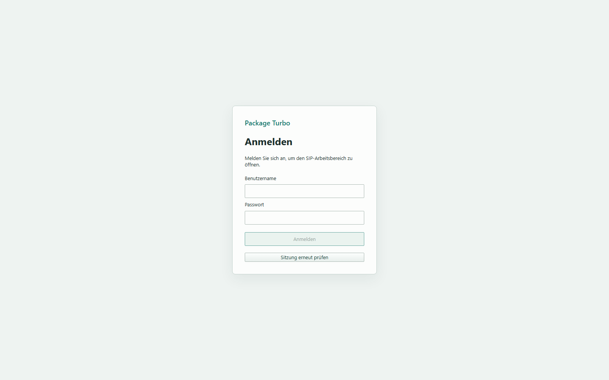

The initial workspace contains no selected SIP. Select **Neues Paket** to create one or **Öffnen** to open an existing workspace or import a ZIP.

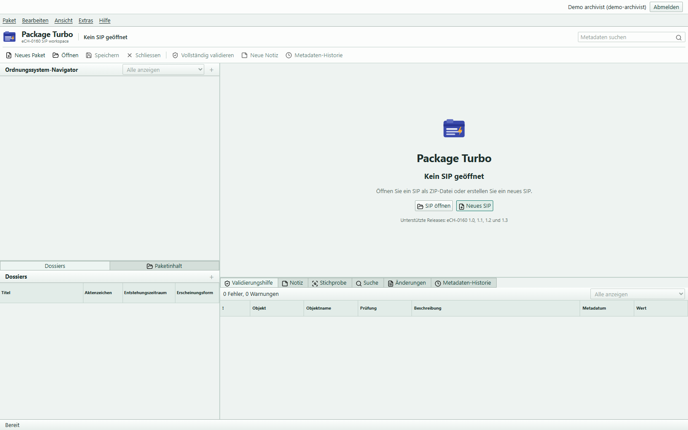

## 2. Understand the workspace

The top menu and toolbar contain package commands. The upper-left **Ordnungssystem-Navigator** shows the classification structure. The lower-left area switches between **Dossiers** and **Paketinhalt**. The large central editor shows metadata, statistics or validation checks. The lower-right tools show validation issues, notes, samples, search, pending changes and metadata history. The footer reports progress and errors.

Select an item in a navigator to inspect its metadata. Expand a tree branch using its arrow. Use the editor tabs to change the central view and the tool tabs to change the results pane. A disabled command is unavailable for the current selection, pending changes, read-only package or operation in progress.

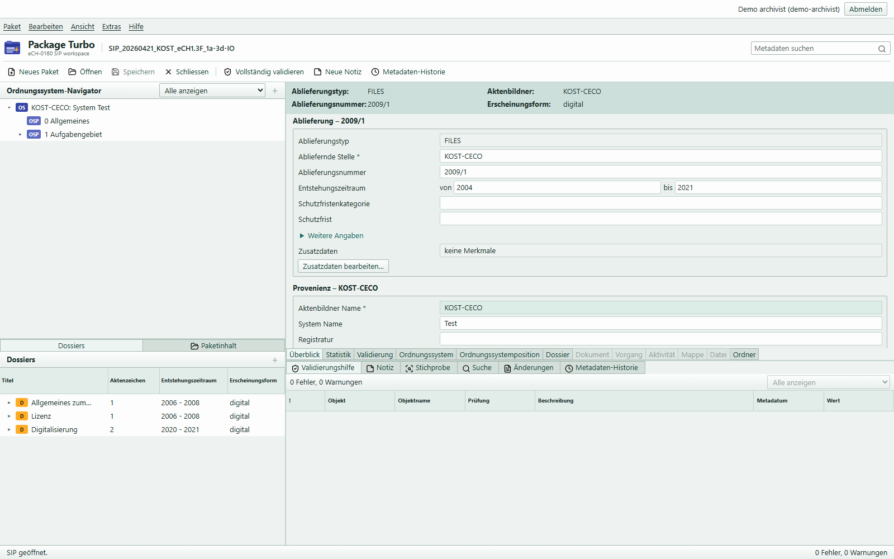

## 3. Create a package

1. Select **Neues Paket**.
2. Enter **Abliefernde Stelle** (the delivering organization). Optionally enter a reference, creator and classification-system name.
3. Choose **Ablieferungstyp**: GEVER or FILES, according to the source material and receiving archive's requirements.
4. Choose the **eCH-0160 Release**. The available releases are 1.0, 1.1, 1.2 and 1.3.
5. Leave **SIP-Name** blank for a suggested name, or use `SIP_YYYYMMDD_Office_Reference`, for example `SIP_20261113_Training_001`. Use letters, digits, dots and hyphens in the office component; spaces are not accepted.
6. Optionally supply an **Ordnungssystem als CSV**, then select **Erstellen**.

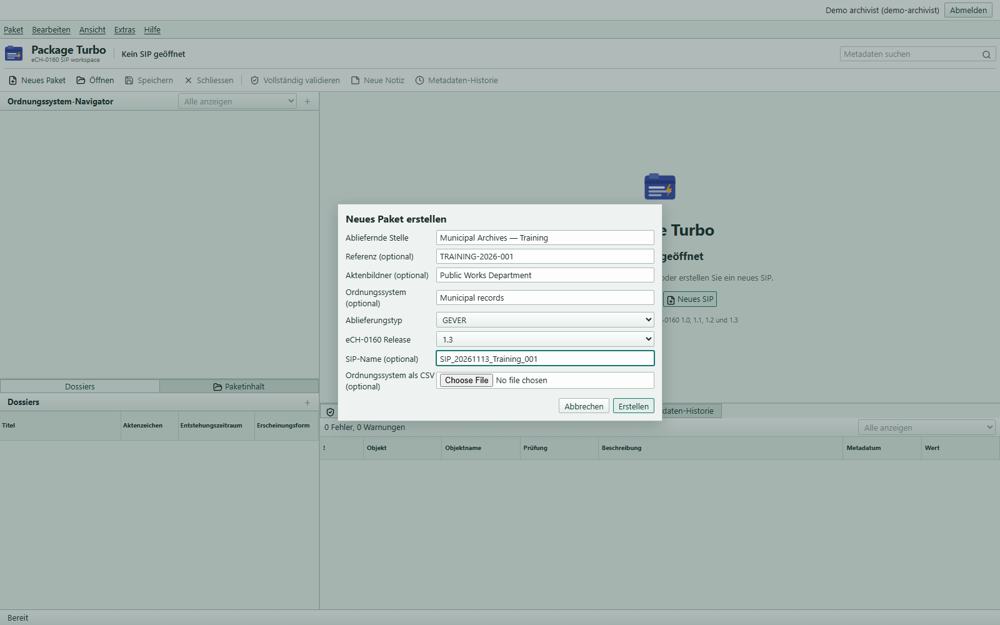

The new package opens in the overview. Check the delivery and provenance metadata before adding structure or content. A newly created package is a starting point; complete and validate it before export.

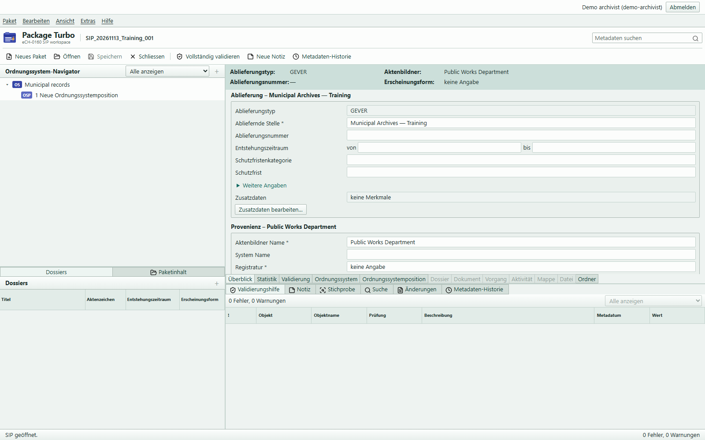

## 4. Open a workspace or import a SIP

Select **Öffnen**. To resume work, select a saved package from the list. To import a SIP, choose a ZIP file under **ZIP-Datei**, optionally enable **Schreibgeschützt**, and select **ZIP importieren**. Wait until the package opens before issuing another command.

To inspect metadata alone, choose a file under **Einzelne metadata.xml** and select **XML schreibgeschützt öffnen**. This opens a read-only metadata view, without the full package content.

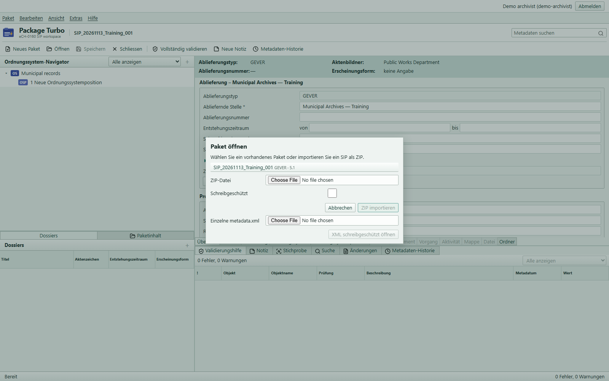

Work on a copy and retain the original delivery. Importing a ZIP creates a workspace copy; downloading an updated ZIP later is a separate export step. Unknown schema releases open read-only. **Schreibgeschützt** indicates that editing is unavailable.

## 5. Browse dossiers and files

Use the classification navigator to locate the relevant records group. Switch the lower-left navigator to **Dossiers** to explore dossiers and their descendants. Select a record to display its metadata in the editor. Breadcrumb buttons in object views lead back to parent objects.

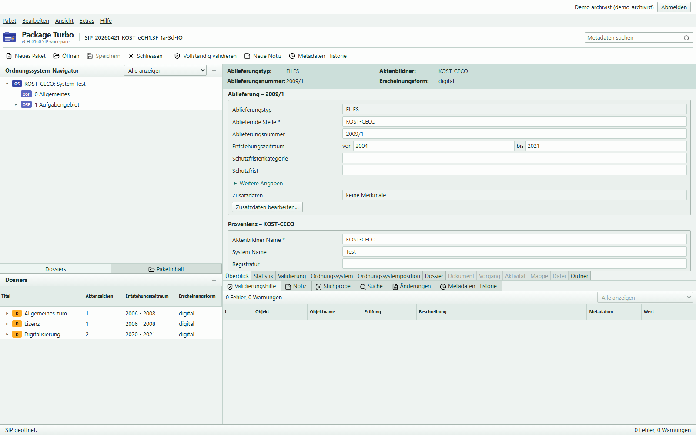

Select **Paketinhalt** to inspect the package's folder and file structure. This is useful when locating content independently of the classification hierarchy.

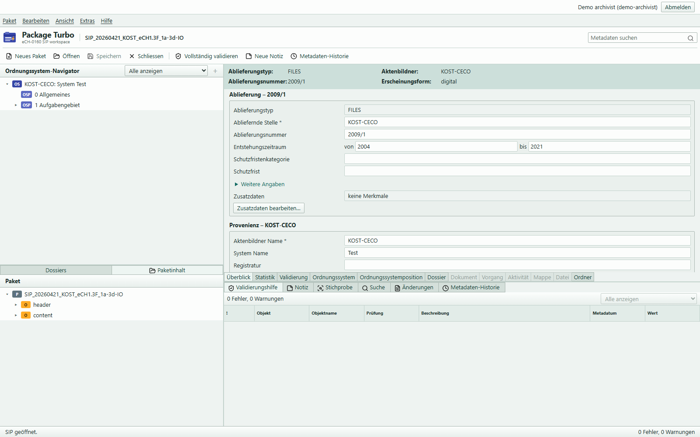

The central **Dossier**, **Dokument**, **Datei** and other object tabs provide views for those object types. Select an actual object in the navigator when you need to edit that object's metadata.

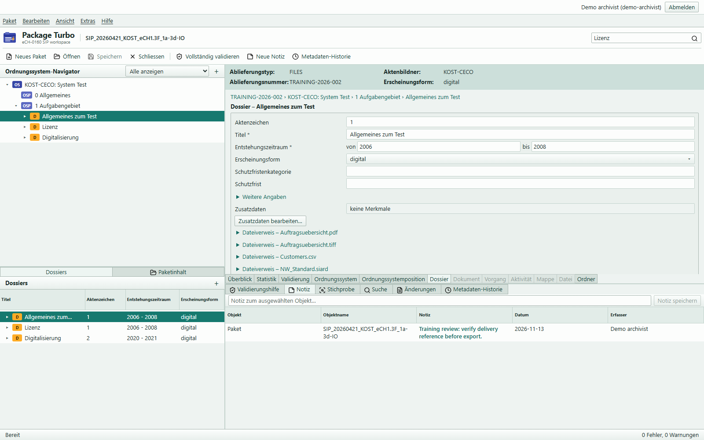

## 6. Edit metadata

1. Select the object or open **Überblick** for delivery and provenance fields.
2. Click the value beside the desired field. Editable values become an input or choice list.
3. Enter the new value. A star marks a required field. Expand **Weitere Angaben** for additional fields.
4. Move focus out of the field to apply its local edit. Check for an error before continuing.
5. Review **Änderungen**, then select the toolbar's **Speichern** to commit the pending package changes.

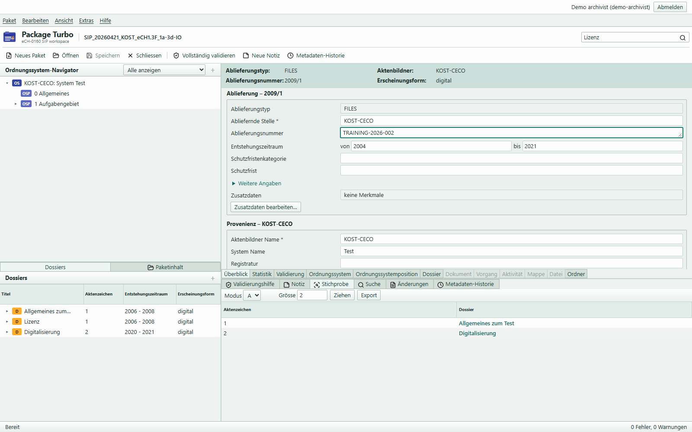

Editing a field and saving the package are separate steps. The **Ungespeichert** indicator and changes count show pending work. Do not rely on an exported ZIP or a closed browser tab to preserve unsaved edits.

## 7. Review, save or discard changes

Open **Änderungen** in the tool tabs or through **Ansicht**. Compare the new **Wert** with **Gespeicherter Wert**. Select an object's name to return to that object. Use the row's discard action for an individual field or **Alle verwerfen** to discard pending changes after confirmation.

Use **Kopieren** or **Export** when you need a review copy of the changes list. These commands do not replace saving the package. Select the top toolbar's **Speichern** when the changes are correct. Finish any active field edit first if Save is disabled.

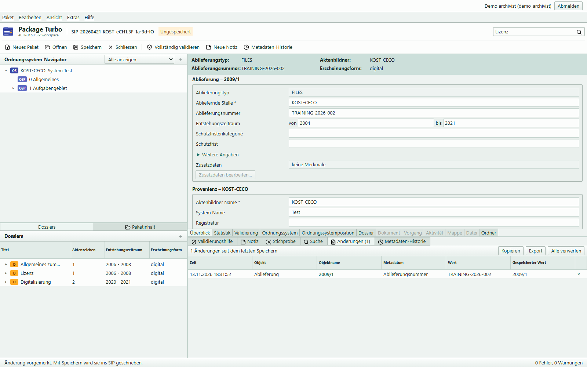

After saving, the pending changes list clears. Permanent audit information is available separately under **Metadaten-Historie**.

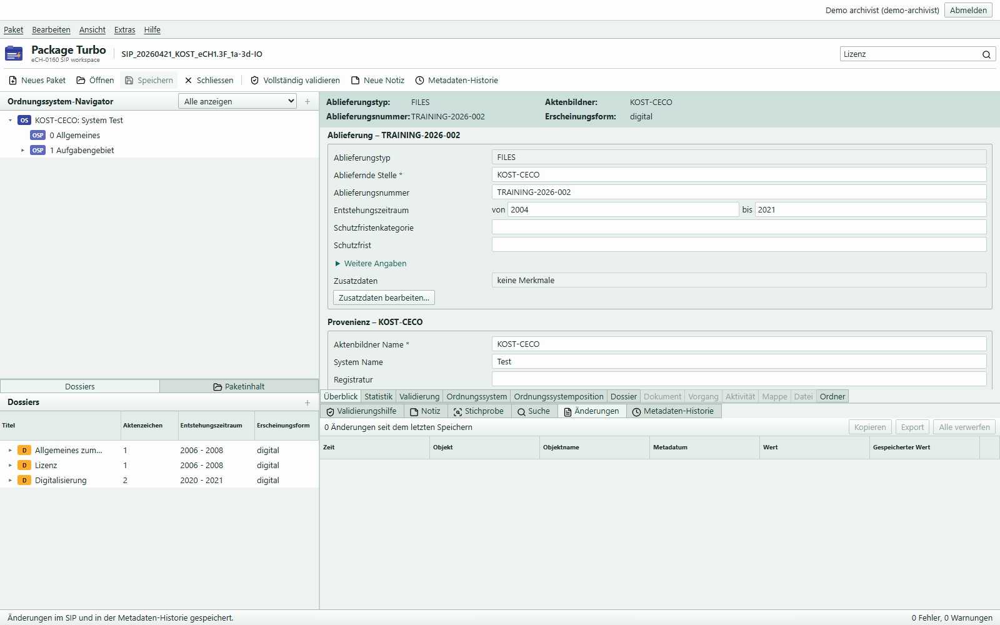

Closing or switching packages with pending edits can prompt you to discard them. Read that prompt carefully; cancel the switch if you still need to save.

## 8. Add objects and manage content

Select a parent object that allows children, then choose **Bearbeiten → Neues Objekt…**, the navigator's **+**, or **+ Objekt hinzufügen** where available. Choose the object type, count and optional title, then select **Hinzufügen**. The available types depend on the selected parent and schema.

Select a file-bearing object to access content commands. Depending on the selection, **Datei hinzufügen…**, **Datei ersetzen…** or **Paketaktionen…** may be available. Choose the content, review any replacement confirmation, then save the staged package changes. Download links retrieve existing file content.

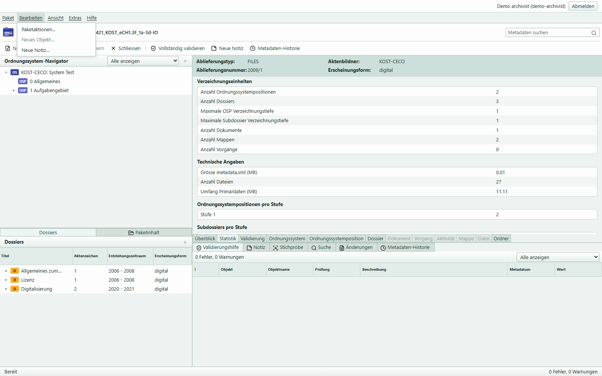

Resolve pending metadata changes before using commands that require a clean workspace. A file replacement can change checksums and relationships; run full validation after content changes. Keep an original copy before replacing or removing material.

## 9. Review additional data

Where supported, select **Zusatzdaten bearbeiten…** below an object's fields. Review the structured entries in the dialog, make the intended changes and use its save action. Cancel to leave the dialog without submitting changes. File objects may also expose **Dateieigenschaften bearbeiten…** for file properties.

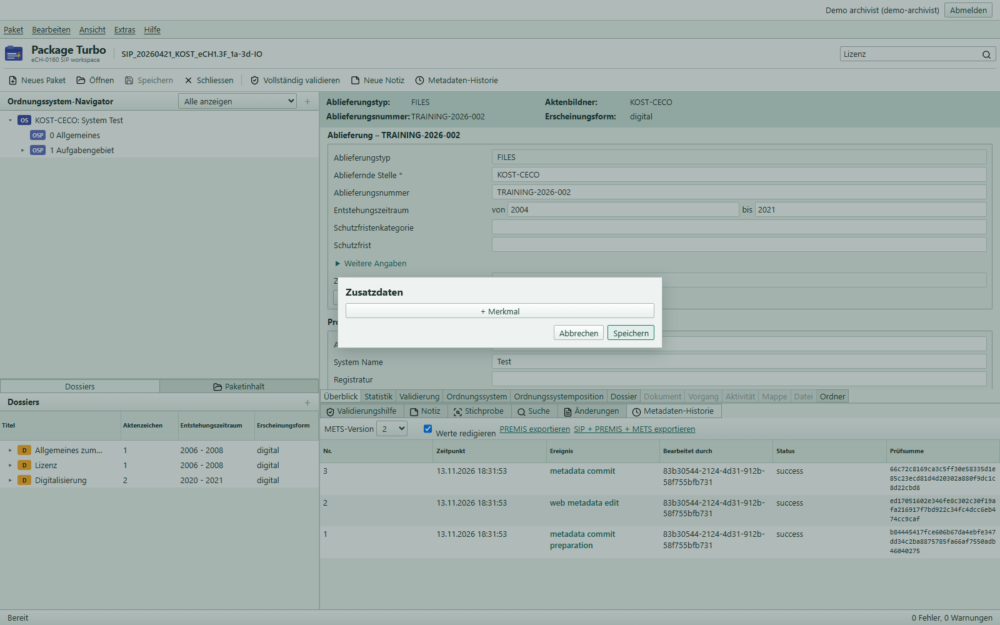

## 10. Validate the package

Select **Vollständig validieren** in the top toolbar or **Extras**. Wait for the operation to finish. The central **Validierung** view lists checks and their error and warning counts; the lower-right **Validierungshilfe** lists individual issues.

Use **Validierungshinweise filtern** to show errors, warnings or all issues. Select an issue's object link to inspect the affected metadata. Where a check offers **Anzeigen**, use it to focus its issues. Correct the underlying problem, save, then validate again.

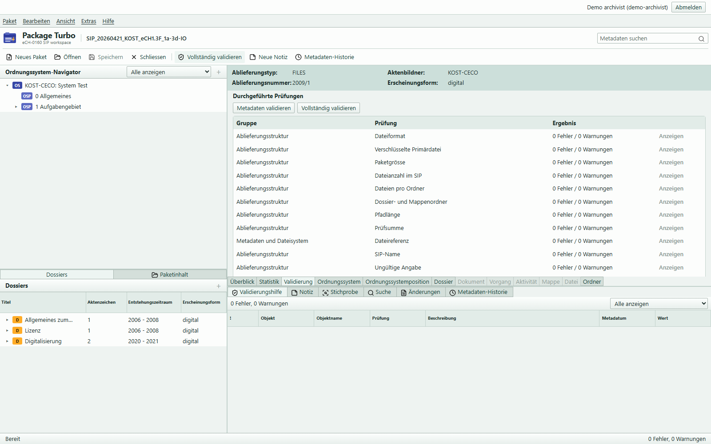

**Metadaten validieren** checks metadata; full validation also considers the package. Zero reported errors means the implemented checks found none; the receiving archive may have additional requirements. Read warnings as well as errors.

## 11. Inspect statistics

Select **Statistik** in the central editor or **Ansicht → Statistik**. Review the displayed package summaries as a consistency check, especially after importing content or changing structure.

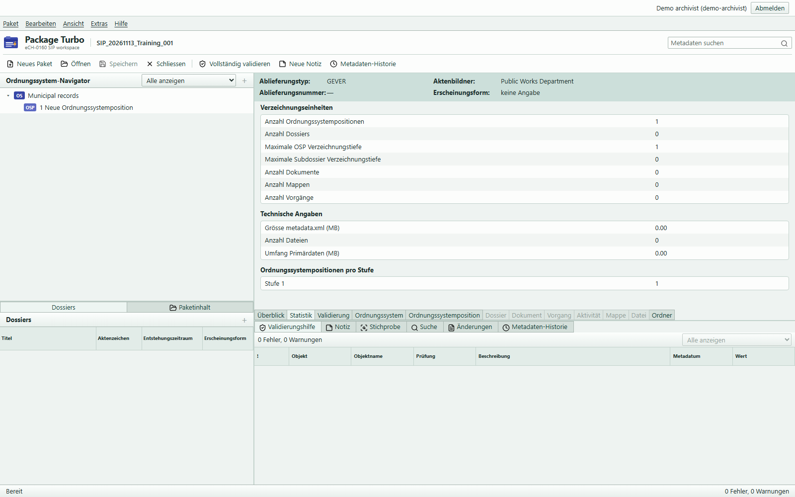

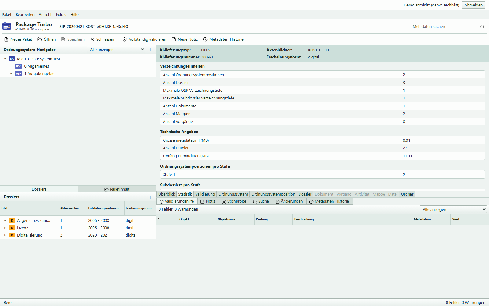

## 12. Search metadata

Use the top **Metadaten suchen** field for a quick search or open the **Suche** tool. In **Einfache Suche**, enter a term and select **Suchen**. Results identify the object, object name, metadata field and matching value. Select an object name to navigate to it.

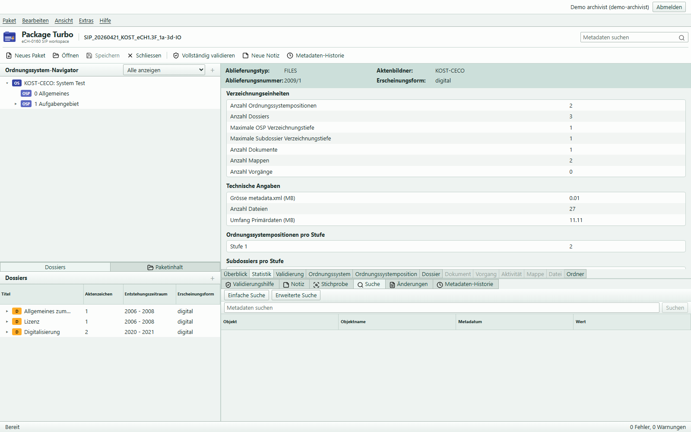

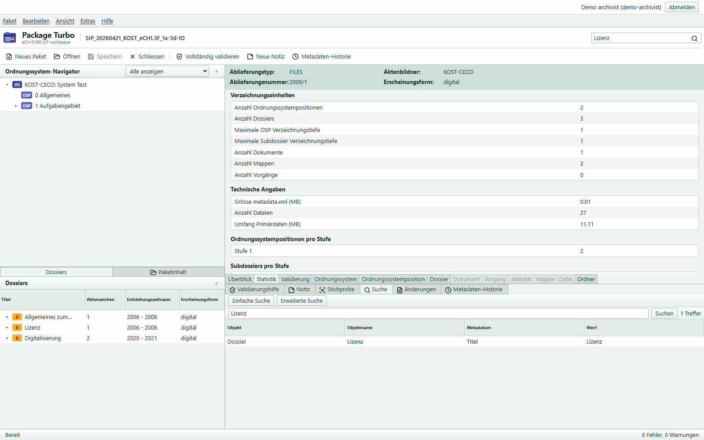

Select **Erweiterte Suche** for structured criteria. Choose an **Objekttyp**, a metadata field and a value. Use **Leer** when looking for empty values. Add conditions with **+ Bedingung**; the interface supports up to three criteria. Inspect the available controls and select **Suchen** to run the query.

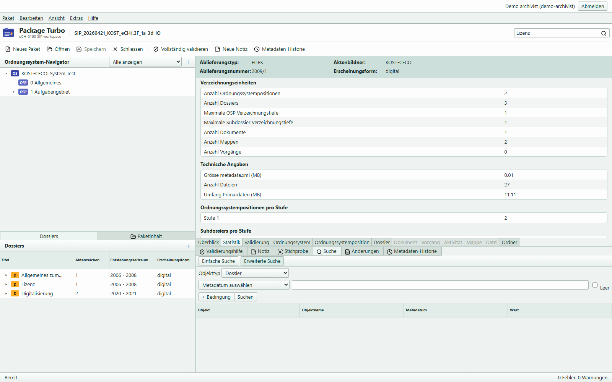

Search covers metadata rather than the full text of every content file. If results are unexpected, try a shorter metadata term or a different object type.

## 13. Draw a dossier sample

Open **Stichprobe**. Choose **Anzahl** for a fixed number or **Prozent** for a percentage, enter **Grösse**, and select **Ziehen**. Select a returned dossier to inspect it. **Export** downloads the displayed sample list. Drawing a sample supports review; it does not replace validating the whole SIP.

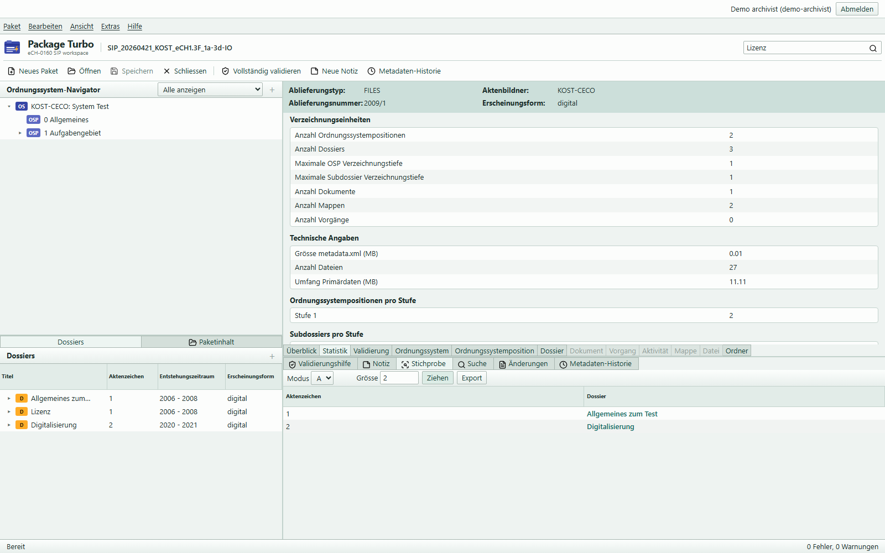

## 14. Add review notes

Select an object that supports notes, then select **Neue Notiz** or the **Notiz** tool. Enter your text under **Neue Notiz** and select **Notiz speichern**. The table shows the note, related object, date and author. **Alle Notizen**, when displayed, returns from an object-specific list to all notes.

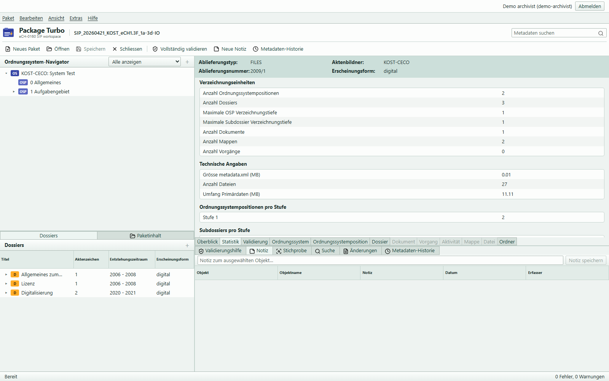

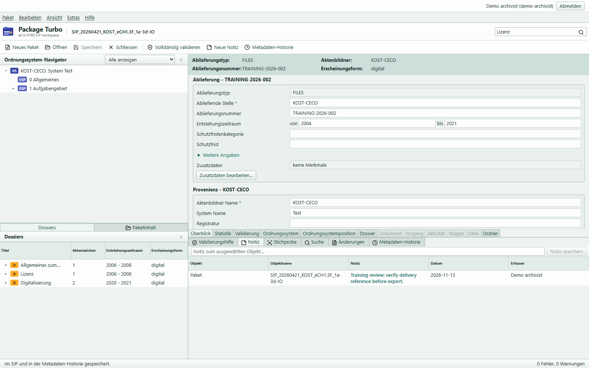

Resolve pending changes if **Notiz speichern** is disabled. Notes support review and context; they do not correct the metadata or resolve validation errors automatically.

## 15. Inspect metadata history

Select **Metadaten-Historie** in the toolbar or tool tabs. Review event time, type, operator, status and checksum. Unlike **Änderungen**, history persists after saving and reopening. Select an event to inspect its recorded details.

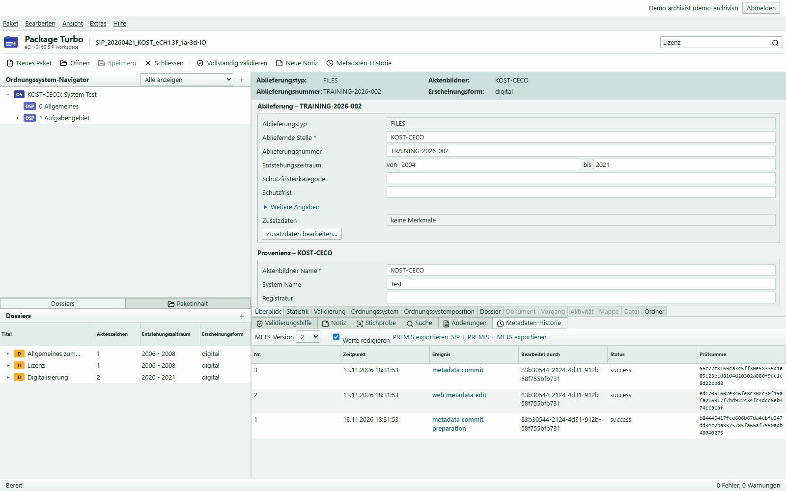

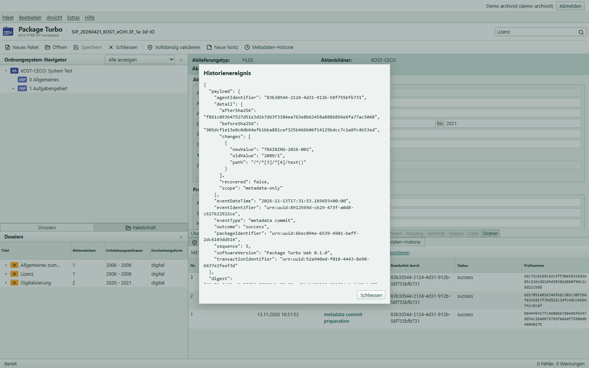

Where offered, use **PREMIS exportieren** or **SIP + PREMIS + METS exportieren** for preservation output. Select the METS version required by the recipient. Review **Werte redigieren** before exporting if recorded field values should be redacted. Preserve the workspace and its companion audit information when backing up or migrating it.

## 16. Export a package or report

Save pending changes, run full validation and review the results. Choose **Paket → Paket zippen…** to download the SIP ZIP. Check your browser's download location. Exporting creates a download; it does not overwrite the ZIP you originally imported.

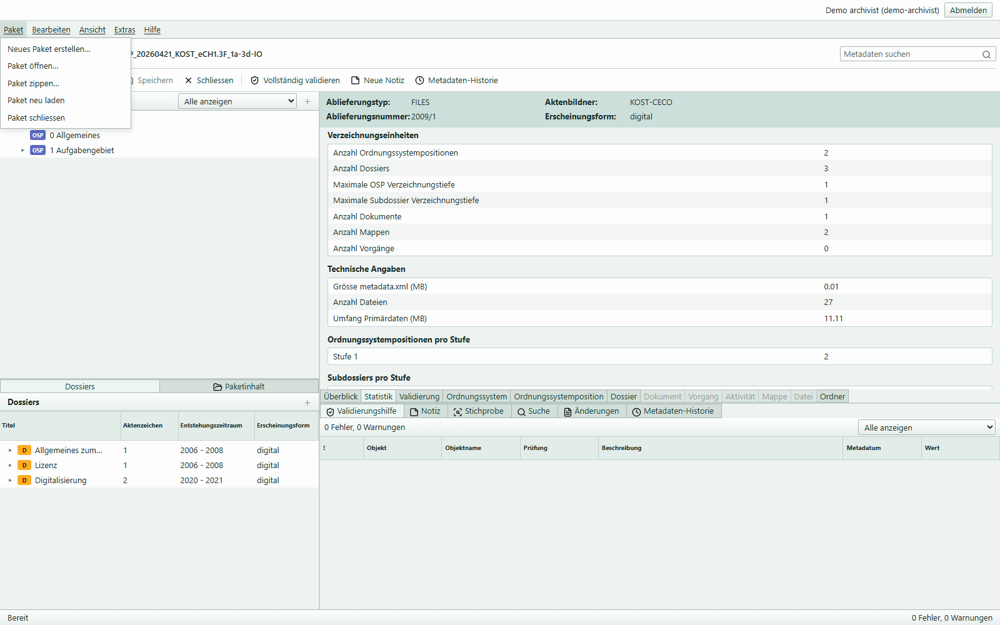

Use **Extras → metadata.xml exportieren…** for metadata alone. **Extras** also lists available reports and the full-validation and history commands. A metadata-only export is not a complete SIP delivery.

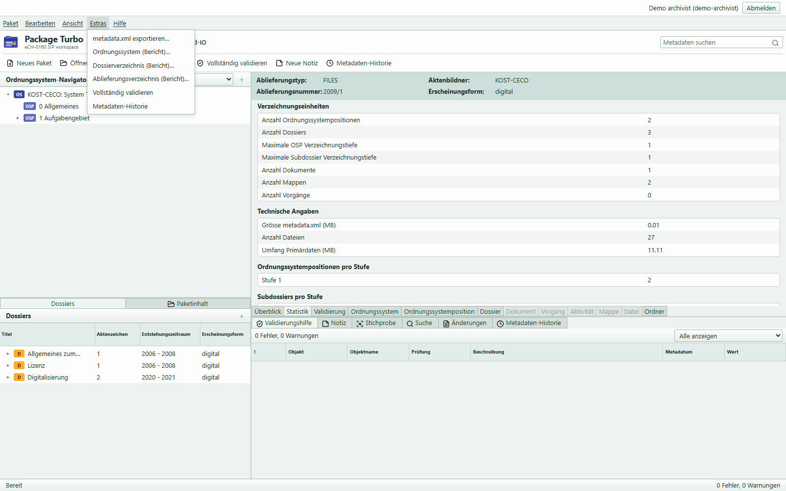

Before handing over a package, confirm the receiving archive's schema release, delivery type and additional requirements. Retain a copy of the exported ZIP and the validation evidence relevant to your process.

## 17. Finish a session

Save or deliberately discard pending changes. Use **Schliessen** to close the current SIP and **Abmelden** to end the browser session. The server can keep running for later use. If you started it in PowerShell, Ctrl+C in that server terminal stops it.

Use **Ansicht** to return to overview, statistics, package content or changes while working.

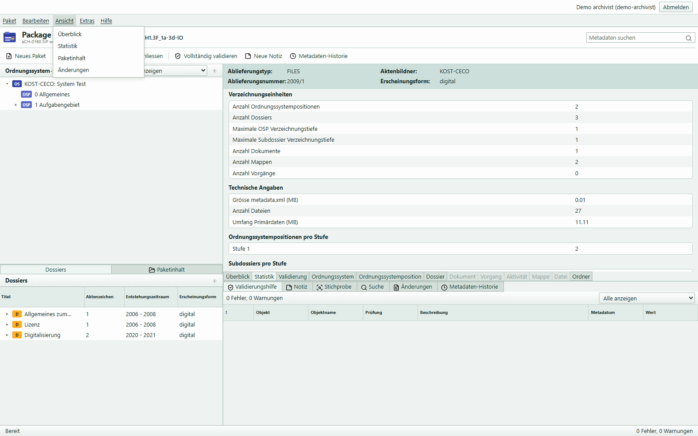

## 18. Troubleshooting

- **The page does not open:** use http://127.0.0.1:7000 and confirm that the startup terminal reached the running-server stage. Builds can take time. A different service may be using port 8000.
- **The password is rejected after a reset:** restart the server so it loads the new configuration. The startup script loads `login.env` only when neither login environment variable is already set. In the PowerShell session used to start the server, remove stale overrides with `Remove-Item Env:PACKAGE_TURBO_LOGIN_USERNAME, Env:PACKAGE_TURBO_LOGIN_PASSWORD_HASH -ErrorAction SilentlyContinue`, then start the script again.
- **PowerShell blocks npm.ps1:** use the Windows command shim `npm.cmd` for manual npm commands. If the startup script fails at npm, report the exact terminal error.
- **No credentials are configured:** configure both username and password hash, then restart. There is no built-in default password or password recovery screen.
- **The session expired:** sign in again. The login screen explains that unsaved changes may need to be entered again.
- **An edit control is unavailable:** check for **Schreibgeschützt**, an unsupported schema release, the selected object, an active operation, or pending changes.
- **Save is disabled:** finish the current field edit and check whether there are pending changes. Read any field or footer error.
- **Package creation rejects the name:** leave the custom SIP name blank or use the documented `SIP_YYYYMMDD_Office_Reference` form.
- **Import fails:** read the footer or dialog error. Check that you selected a SIP ZIP rather than an arbitrary ZIP. The default upload limit is 256 MiB and the default expanded-size limit is 1 GiB; configuration can change these values.
- **A save was interrupted:** inspect Metadata History for a recovery action before continuing. Retain the workspace and companion files; avoid manually editing them while the app is running.
- **A download seems missing:** inspect the browser's Downloads list and any download prompt. ZIP, XML and report downloads are separate from saving workspace edits.

## Quick workflow checklist

1. Start the service and sign in.
2. Open/import an existing SIP or create a new package.
3. Browse the structure and review delivery/provenance metadata.
4. Edit metadata and content, review changes and save.
5. Run full validation; correct and recheck issues.
6. Review statistics, notes and history as needed.
7. Download the final SIP ZIP and any required reports or preservation output.
8. Retain the original, your final export and required audit evidence; sign out.

For installation, storage, recovery and administrator settings, see [Web development and operations](../web-workspace.md). This manual documents the browser workflow captured from this checkout; it is not a statement of complete standards compliance.
